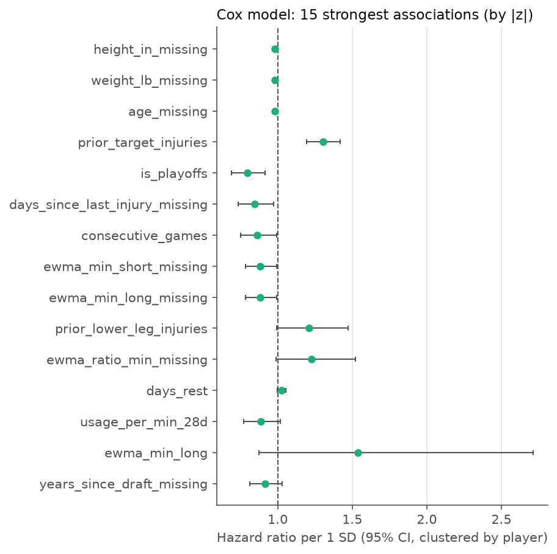
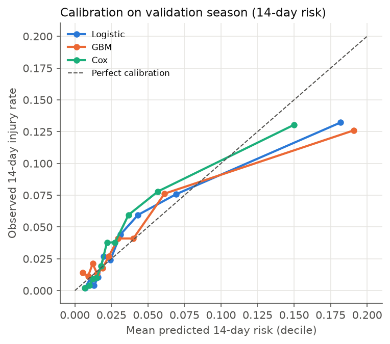
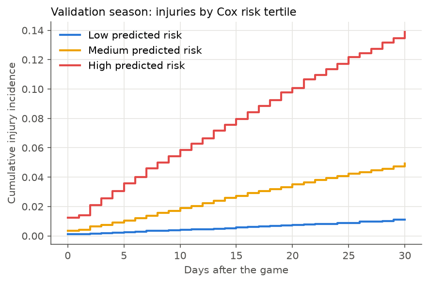

# Baseline models (validation season 2022-23)

Training: 2016-17–2021-22 (160,783 landmarks, 5,425 event landmarks). Validation: 27,740 landmarks, 1,472 event landmarks. **The test season (2023-24) was not used.**

Features: 42 (55 model columns after missing indicators). Gradient boosting: scikit-learn HistGradientBoosting (xgboost not installed). Hyperparameters fixed in advance (no tuning).

## Main results

C-index is the primary metric (0.5 = random ranking). AUC and Brier are for injury within 14 days, on landmarks whose 14-day outcome is known. 95% CIs bootstrap players (200 resamples). The `Cox:` rows are simple reference models using one feature family each.

| model | c_index | auc_14d | brier_14d | mean_predicted_14d | observed_14d | c_index_95ci | auc_14d_95ci |
|---|---|---|---|---|---|---|---|
| Logistic | 0.758 | 0.772 | 0.037 | 0.042 | 0.039 | 0.712–0.794 | 0.726–0.808 |
| GBM | 0.715 | 0.725 | 0.038 | 0.041 | 0.039 | 0.661–0.768 | 0.671–0.780 |
| Cox | 0.764 | 0.776 | 0.037 | 0.036 | 0.039 | 0.725–0.799 | 0.736–0.812 |
| Cox: injury history only | 0.759 | 0.769 | 0.037 | 0.037 | 0.039 | 0.720–0.796 | 0.731–0.808 |
| Cox: minutes only (EWMA) | 0.670 | 0.685 | 0.037 | 0.022 | 0.039 | 0.622–0.716 | 0.636–0.733 |
| Cox: workload + schedule/travel | 0.720 | 0.729 | 0.037 | 0.031 | 0.039 | 0.681–0.761 | 0.691–0.772 |
| Cox (season-stratified) | 0.763 | 0.775 |  |  | 0.039 | 0.723–0.798 | 0.734–0.812 |

## What drives the ranking

- Injury history alone reaches C = 0.759; the full Cox model 0.764. Workload + schedule/travel without history: 0.720; minutes alone: 0.670.
- Diagnostic: ranking each player's games by his season-average Cox risk gives C = 0.799, higher than the game-by-game model. The C-index is therefore driven mainly by identifying *which* players get hurt (injury history, playing time), not *when*.
- Whether recent workload predicts the *timing* of an injury within a player needs a within-player design (e.g., a model stratified by player), planned with the sequence model.

## Sensitivity analyses (same validation season)

`from_2018_19` drops the two seasons with heavy reason-less injured-list placements; `excl_2019_21` drops the bubble and shortened seasons (proposal section 6).

| run | train_seasons | model | c_index | auc_14d | brier_14d |
|---|---|---|---|---|---|
| main | 2016-17..2021-22 | Logistic | 0.758 | 0.772 | 0.037 |
| main | 2016-17..2021-22 | GBM | 0.715 | 0.725 | 0.038 |
| main | 2016-17..2021-22 | Cox | 0.764 | 0.776 | 0.037 |
| main | 2016-17..2021-22 | Cox (season-stratified) | 0.763 | 0.775 |  |
| from_2018_19 | 2018-19..2021-22 | Logistic | 0.758 | 0.772 | 0.038 |
| from_2018_19 | 2018-19..2021-22 | GBM | 0.728 | 0.738 | 0.037 |
| from_2018_19 | 2018-19..2021-22 | Cox | 0.766 | 0.777 | 0.037 |
| excl_2019_21 | 2016-17..2021-22 (excl. 2019-21) | Logistic | 0.751 | 0.767 | 0.037 |
| excl_2019_21 | 2016-17..2021-22 (excl. 2019-21) | GBM | 0.726 | 0.741 | 0.038 |
| excl_2019_21 | 2016-17..2021-22 (excl. 2019-21) | Cox | 0.759 | 0.772 | 0.037 |

## Cox model: strongest associations (hazard ratio per 1 SD, ranked by |z|)

Robust 95% CIs clustered by player. Workload features are strongly correlated with each other, so individual hazard ratios among them should not be read as separate effects. `hr_stratified` = same feature in the season-stratified Cox model.

| feature | hr | hr_lo | hr_hi | p | hr_stratified |
|---|---|---|---|---|---|
| height_in_missing | 0.983 | 0.979 | 0.987 | <0.001 | 0.983 |
| weight_lb_missing | 0.983 | 0.979 | 0.987 | <0.001 | 0.983 |
| age_missing | 0.983 | 0.979 | 0.987 | <0.001 | 0.983 |
| prior_target_injuries | 1.303 | 1.196 | 1.419 | <0.001 | 1.304 |
| is_playoffs | 0.795 | 0.692 | 0.915 | 0.001 | 0.786 |
| days_since_last_injury_missing | 0.846 | 0.735 | 0.973 | 0.019 | 0.850 |
| consecutive_games | 0.864 | 0.752 | 0.993 | 0.039 | 0.861 |
| ewma_min_short_missing | 0.883 | 0.784 | 0.994 | 0.040 | 0.882 |
| ewma_min_long_missing | 0.883 | 0.784 | 0.994 | 0.040 | 0.882 |
| prior_lower_leg_injuries | 1.211 | 0.995 | 1.473 | 0.056 | 1.214 |
| ewma_ratio_min_missing | 1.226 | 0.989 | 1.521 | 0.063 | 1.224 |
| days_rest | 1.026 | 0.998 | 1.054 | 0.065 | 1.019 |
| usage_per_min_28d | 0.886 | 0.770 | 1.019 | 0.089 | 0.885 |
| ewma_min_long | 1.539 | 0.874 | 2.711 | 0.136 | 1.543 |
| years_since_draft_missing | 0.916 | 0.814 | 1.030 | 0.142 | 0.914 |

## Calibration (Cox, 14-day risk, deciles)

| bin | n | mean_predicted | observed |
|---|---|---|---|
| 1 | 2269 | 0.007 | 0.002 |
| 2 | 2269 | 0.010 | 0.004 |
| 3 | 2268 | 0.012 | 0.009 |
| 4 | 2269 | 0.015 | 0.010 |
| 5 | 2269 | 0.018 | 0.019 |
| 6 | 2268 | 0.022 | 0.038 |
| 7 | 2269 | 0.028 | 0.038 |
| 8 | 2268 | 0.037 | 0.060 |
| 9 | 2269 | 0.057 | 0.078 |
| 10 | 2269 | 0.150 | 0.130 |

## Risk groups

Kaplan–Meier by tertile of Cox predicted risk (log-rank χ² = 1087.4, df 2). The log-rank test treats every landmark as independent, but a player's landmarks overlap, so its p-value overstates certainty and is not reported; the player-bootstrap CIs above are the reliable measure of uncertainty.

## Notes

- Ties: at most 0.37% of a risk set is injured on the same day, so Breslow's tie method is accurate here.
- Cox converged in 11 Newton iterations.
- Logistic/GBM are trained only on landmarks with a known 14-day outcome, so late-season landmarks (cut off by season end) are underrepresented in their training data.
- Hazard ratios describe associations in this observational data, not causes.