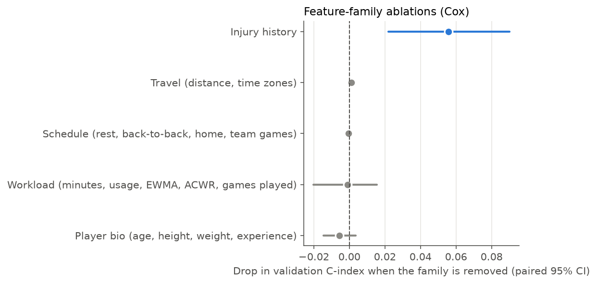

# Feature-family ablations (Cox, validation season 2022-23)

Full Cox model C-index: **0.764** (42 features). Each row refits the model without one family. `c_drop` > 0 means the family helps; the paired 95% CI comes from scoring both models on the same 200 bootstrap resamples of players. A CI that excludes 0 is a reliable contribution.

| family | n_features | c_without | c_drop | ci_lo | ci_hi |
|---|---|---|---|---|---|
| Injury history | 4 | 0.709 | 0.056 | 0.022 | 0.090 |
| Travel (distance, time zones) | 5 | 0.763 | 0.001 | -0.000 | 0.002 |
| Schedule (rest, back-to-back, home, team games) | 5 | 0.765 | -0.000 | -0.001 | -0.000 |
| Workload (minutes, usage, EWMA, ACWR, games played) | 22 | 0.766 | -0.001 | -0.020 | 0.015 |
| Player bio (age, height, weight, experience) | 4 | 0.770 | -0.006 | -0.014 | 0.004 |

