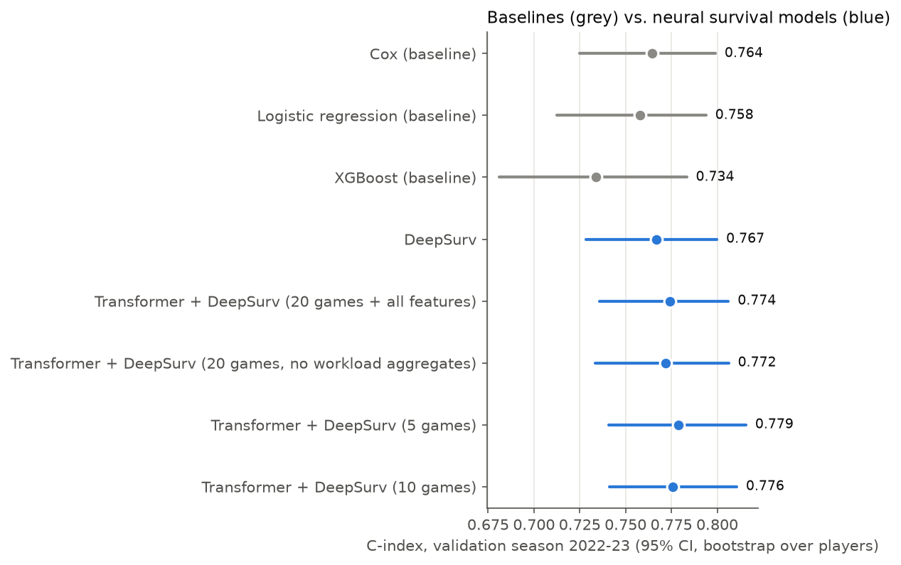

# Update 3: neural survival models vs. baselines (validation season 2022-23)

Neural rows use the seed ensemble (average standardized log-risk over seeds); `c_sd_over_seeds` is the spread of single-seed C-indices. `c_minus_cox` and its paired 95% CI compare each model with the Cox baseline on the same bootstrap resamples of players: an interval containing 0 means no reliable difference. The test season (2023-24) was not used.

| model | seeds | c_index | c_95ci | c_sd_over_seeds | auc_14d | c_minus_cox | paired_95ci |
|---|---|---|---|---|---|---|---|
| Cox (baseline) | 1 | 0.764 | 0.725–0.799 |  | 0.776 | 0.000 | +0.000 to +0.000 |
| Logistic regression (baseline) | 1 | 0.758 | 0.712–0.794 |  | 0.772 | -0.006 | -0.013 to +0.000 |
| XGBoost (baseline) | 1 | 0.734 | 0.681–0.783 |  | 0.744 | -0.030 | -0.064 to +0.003 |
| DeepSurv | 3 | 0.767 | 0.728–0.800 | 0.016 | 0.777 | 0.002 | -0.007 to +0.013 |
| Transformer + DeepSurv (20 games + all features) | 3 | 0.774 | 0.736–0.806 | 0.008 | 0.786 | 0.010 | -0.003 to +0.024 |
| Transformer + DeepSurv (20 games, no workload aggregates) | 3 | 0.772 | 0.734–0.806 | 0.009 | 0.784 | 0.007 | -0.008 to +0.024 |
| Transformer + DeepSurv (5 games) | 3 | 0.779 | 0.741–0.816 | 0.008 | 0.791 | 0.015 | +0.003 to +0.029 |
| Transformer + DeepSurv (10 games) | 3 | 0.776 | 0.741–0.811 | 0.004 | 0.787 | 0.011 | -0.001 to +0.025 |

## DeepSurv feature-family ablations (seed ensembles)

| family removed | c_without | c_drop | ci_lo | ci_hi |
|---|---|---|---|---|
| workload | 0.767 | 0.000 | -0.016 | 0.018 |
| schedule | 0.766 | 0.001 | -0.004 | 0.006 |
| travel | 0.776 | -0.009 | -0.019 | -0.000 |
| history | 0.719 | 0.048 | 0.014 | 0.084 |
| bio | 0.775 | -0.008 | -0.018 | 0.001 |

## Training details (per seed)

| run | seed | epochs | inner_c | c_index | auc_14d | brier_14d |
|---|---|---|---|---|---|---|
| deepsurv | 0 | 7 | 0.706 | 0.774 | 0.784 | 0.036 |
| deepsurv | 1 | 18 | 0.745 | 0.743 | 0.753 | 0.037 |
| deepsurv | 2 | 6 | 0.750 | 0.764 | 0.774 | 0.036 |
| tf_full | 0 | 5 | 0.718 | 0.760 | 0.771 | 0.036 |
| tf_full | 1 | 8 | 0.732 | 0.776 | 0.788 | 0.037 |
| tf_full | 2 | 5 | 0.755 | 0.767 | 0.778 | 0.036 |
| tf_seq | 0 | 5 | 0.715 | 0.771 | 0.784 | 0.036 |
| tf_seq | 1 | 5 | 0.723 | 0.759 | 0.771 | 0.037 |
| tf_seq | 2 | 6 | 0.729 | 0.777 | 0.788 | 0.036 |
| tf_len5 | 0 | 5 | 0.711 | 0.771 | 0.782 | 0.036 |
| tf_len5 | 1 | 8 | 0.734 | 0.785 | 0.797 | 0.036 |
| tf_len5 | 2 | 6 | 0.745 | 0.771 | 0.784 | 0.037 |
| tf_len10 | 0 | 5 | 0.721 | 0.768 | 0.779 | 0.036 |
| tf_len10 | 1 | 6 | 0.727 | 0.775 | 0.788 | 0.036 |
| tf_len10 | 2 | 8 | 0.738 | 0.770 | 0.783 | 0.037 |
| deepsurv_no_workload | 0 | 14 | 0.738 | 0.767 | 0.776 | 0.036 |
| deepsurv_no_workload | 1 | 16 | 0.716 | 0.767 | 0.776 | 0.036 |
| deepsurv_no_workload | 2 | 8 | 0.735 | 0.762 | 0.771 | 0.036 |
| deepsurv_no_schedule | 0 | 12 | 0.712 | 0.753 | 0.764 | 0.036 |
| deepsurv_no_schedule | 1 | 9 | 0.730 | 0.765 | 0.775 | 0.036 |
| deepsurv_no_schedule | 2 | 6 | 0.756 | 0.769 | 0.781 | 0.037 |
| deepsurv_no_travel | 0 | 5 | 0.704 | 0.770 | 0.782 | 0.036 |
| deepsurv_no_travel | 1 | 9 | 0.737 | 0.768 | 0.781 | 0.036 |
| deepsurv_no_travel | 2 | 6 | 0.753 | 0.766 | 0.776 | 0.036 |
| deepsurv_no_history | 0 | 6 | 0.699 | 0.724 | 0.732 | 0.037 |
| deepsurv_no_history | 1 | 13 | 0.699 | 0.715 | 0.723 | 0.037 |
| deepsurv_no_history | 2 | 6 | 0.689 | 0.706 | 0.715 | 0.037 |
| deepsurv_no_bio | 0 | 7 | 0.703 | 0.778 | 0.786 | 0.036 |
| deepsurv_no_bio | 1 | 13 | 0.733 | 0.760 | 0.773 | 0.036 |
| deepsurv_no_bio | 2 | 6 | 0.752 | 0.775 | 0.784 | 0.036 |

## See also

- `within_player.md`: does recent workload predict *when* a player is injured?
- `ablations.md`: Cox feature-family ablations.