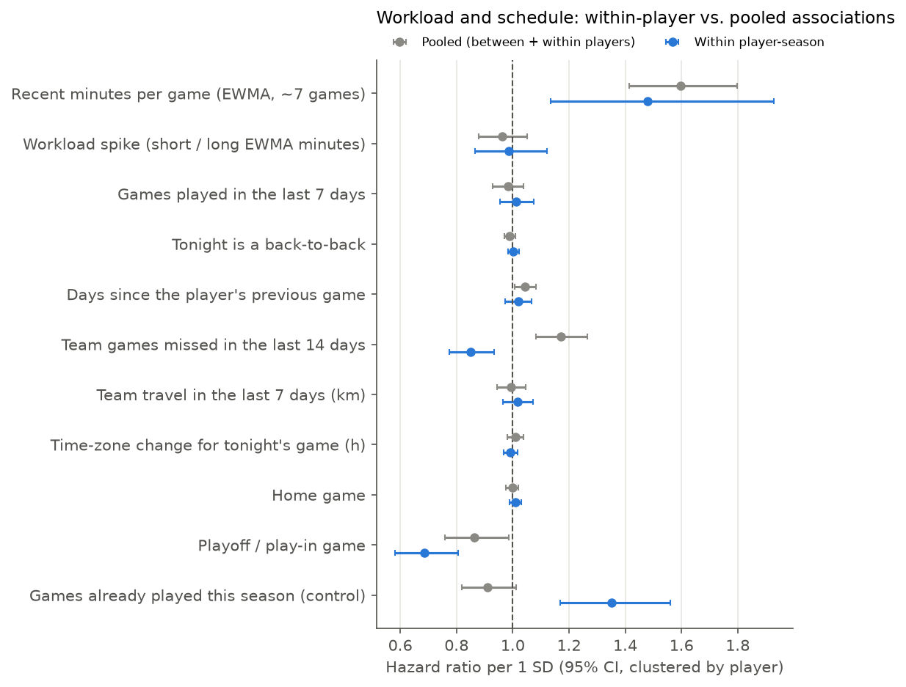

# Within-player timing analysis (training seasons)

Cox model stratified by player-season: each player-season has its own baseline hazard, so estimates reflect game-to-game changes *within* the same player and season. Stable traits (injury history, age, role) cancel out. `pooled` = same features without player strata.

- Player-seasons contributing (≥1 target injury): **430** (24,827 landmarks, 5,425 event landmarks)
- Pooled model: 160,783 landmarks. Features fixed in advance; hazard ratios per 1 SD; robust 95% CIs clustered by player.

| feature | description | hr_within | lo_within | hi_within | p_within | hr_pooled | lo_pooled | hi_pooled | p_pooled |
|---|---|---|---|---|---|---|---|---|---|
| ewma_min_short | Recent minutes per game (EWMA, ~7 games) | 1.479 | 1.134 | 1.929 | 0.004 | 1.596 | 1.415 | 1.799 | <0.001 |
| ewma_ratio_min | Workload spike (short / long EWMA minutes) | 0.986 | 0.867 | 1.123 | 0.836 | 0.962 | 0.880 | 1.052 | 0.397 |
| games_7d | Games played in the last 7 days | 1.013 | 0.954 | 1.076 | 0.673 | 0.982 | 0.929 | 1.039 | 0.533 |
| back_to_back | Tonight is a back-to-back | 1.003 | 0.984 | 1.022 | 0.772 | 0.990 | 0.971 | 1.009 | 0.291 |
| days_since_prev_game | Days since the player's previous game | 1.019 | 0.973 | 1.068 | 0.429 | 1.045 | 1.007 | 1.084 | 0.020 |
| missed_team_games_14d | Team games missed in the last 14 days | 0.850 | 0.773 | 0.935 | <0.001 | 1.170 | 1.083 | 1.265 | <0.001 |
| km_last_7d | Team travel in the last 7 days (km) | 1.017 | 0.965 | 1.072 | 0.535 | 0.994 | 0.944 | 1.047 | 0.833 |
| abs_tz_shift_h | Time-zone change for tonight's game (h) | 0.992 | 0.968 | 1.017 | 0.519 | 1.009 | 0.982 | 1.038 | 0.515 |
| is_home | Home game | 1.009 | 0.988 | 1.031 | 0.406 | 0.998 | 0.977 | 1.020 | 0.872 |
| is_playoffs | Playoff / play-in game | 0.685 | 0.582 | 0.807 | <0.001 | 0.864 | 0.758 | 0.985 | 0.029 |
| season_games_prior | Games already played this season (control) | 1.351 | 1.169 | 1.561 | <0.001 | 0.909 | 0.818 | 1.011 | 0.079 |

## Associations within player-season with p < 0.05

- Recent minutes per game (EWMA, ~7 games): HR 1.48 (1.13–1.93)
- Team games missed in the last 14 days: HR 0.85 (0.77–0.93)
- Playoff / play-in game: HR 0.69 (0.58–0.81)
- Games already played this season (control): HR 1.35 (1.17–1.56)

## Sensitivity: without return-to-play periods

Within-player model refitted without each player's first 10 games after any injury (16,295 landmarks, 3,830 event landmarks). Similar estimates mean the return-from-injury ramp-up does not drive the main results.

| feature | hr_within | lo_within | hi_within | hr_within_noramp | lo_within_noramp | hi_within_noramp |
|---|---|---|---|---|---|---|
| ewma_min_short | 1.479 | 1.134 | 1.929 | 1.504 | 1.035 | 2.187 |
| ewma_ratio_min | 0.986 | 0.867 | 1.123 | 1.010 | 0.840 | 1.214 |
| games_7d | 1.013 | 0.954 | 1.076 | 0.971 | 0.907 | 1.040 |
| back_to_back | 1.003 | 0.984 | 1.022 | 1.013 | 0.991 | 1.036 |
| days_since_prev_game | 1.019 | 0.973 | 1.068 | 1.021 | 0.949 | 1.098 |
| missed_team_games_14d | 0.850 | 0.773 | 0.935 | 1.031 | 0.932 | 1.140 |
| km_last_7d | 1.017 | 0.965 | 1.072 | 1.024 | 0.956 | 1.095 |
| abs_tz_shift_h | 0.992 | 0.968 | 1.017 | 1.008 | 0.978 | 1.039 |
| is_home | 1.009 | 0.988 | 1.031 | 0.994 | 0.969 | 1.020 |
| is_playoffs | 0.685 | 0.582 | 0.807 | 0.658 | 0.535 | 0.809 |
| season_games_prior | 1.351 | 1.169 | 1.561 | 1.535 | 1.262 | 1.867 |

## Notes

- Hazard ratios are associations, not causal effects. Within-player estimates remove stable confounders but not time-varying ones (e.g., a minor knock that both reduces minutes and precedes a reported injury).
- The lower within-player hazard in playoff games may partly reflect reporting: teams make fewer injured-list moves in the playoffs, and follow-up is cut short when a team is eliminated.
- 11 features tested; with this many tests, an isolated p-value near 0.05 can occur by chance (no multiplicity correction applied).