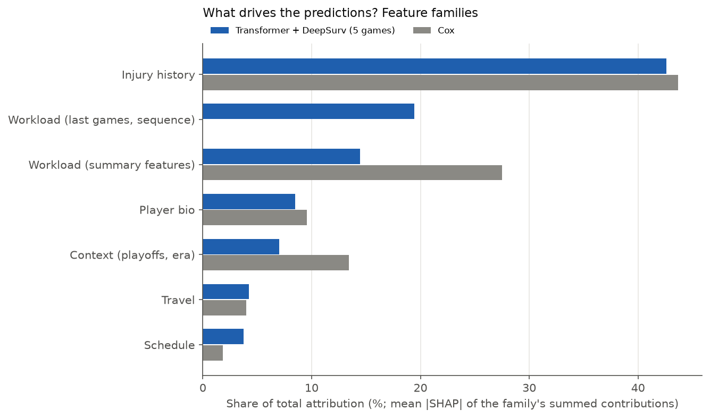
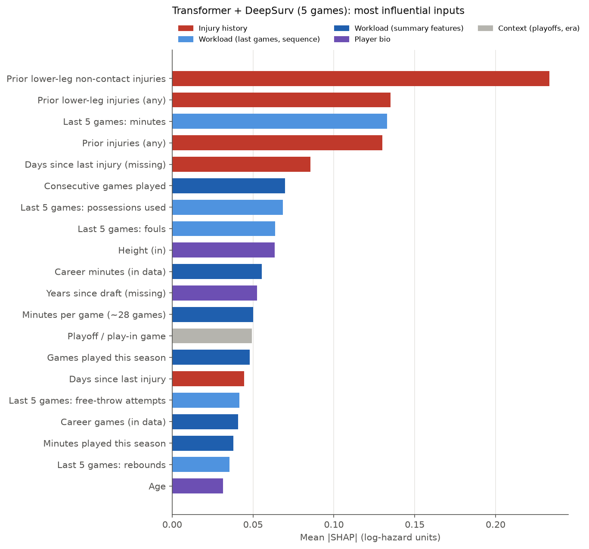
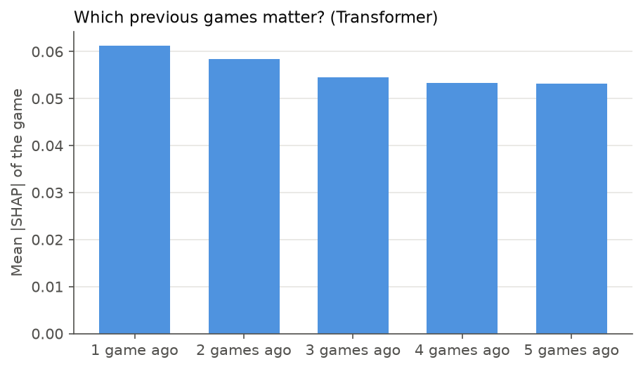
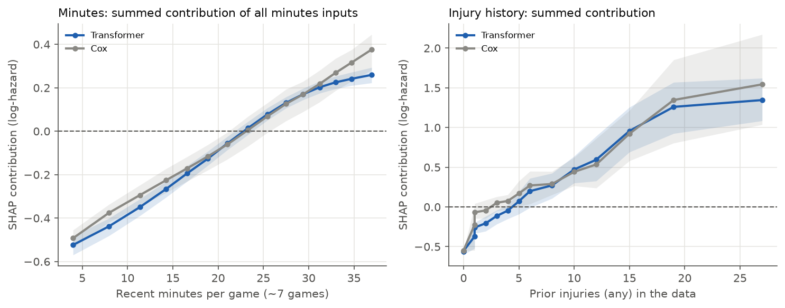

# SHAP explanations of the final models

Explained: 40,541 predictions in the held-out seasons (2023-24 test, 2024-25 supplementary). Transformer + DeepSurv (5 games): expected-gradients SHAP, averaged over the 3 seeds, with 32 samples per prediction and 256 background predictions from the fit seasons. Cox: exact SHAP. Values are in log-hazard units (exp(SHAP) = hazard multiplier).

**Additivity check** (300 predictions): the contributions add up to the model output minus its background average with a mean absolute gap of 0.077 log-hazard (the output's SD is 0.940; correlation 0.995).

## Feature families (share of total attribution)

| family | transformer_mean_abs | transformer_share | cox_mean_abs | cox_share |
|---|---|---|---|---|
| Injury history | 0.510 | 43% | 0.510 | 44% |
| Workload (last games, sequence) | 0.233 | 19% |  |  |
| Workload (summary features) | 0.173 | 14% | 0.321 | 27% |
| Player bio | 0.101 | 8% | 0.111 | 10% |
| Context (playoffs, era) | 0.084 | 7% | 0.157 | 13% |
| Travel | 0.051 | 4% | 0.047 | 4% |
| Schedule | 0.045 | 4% | 0.021 | 2% |

## Most influential inputs (Transformer)

| input | family | mean_abs |
|---|---|---|
| Prior lower-leg non-contact injuries | Injury history | 0.233 |
| Prior lower-leg injuries (any) | Injury history | 0.135 |
| Last 5 games: minutes | Workload (last games, sequence) | 0.133 |
| Prior injuries (any) | Injury history | 0.130 |
| Days since last injury (missing) | Injury history | 0.085 |
| Consecutive games played | Workload (summary features) | 0.070 |
| Last 5 games: possessions used | Workload (last games, sequence) | 0.069 |
| Last 5 games: fouls | Workload (last games, sequence) | 0.064 |
| Height (in) | Player bio | 0.063 |
| Career minutes (in data) | Workload (summary features) | 0.055 |
| Years since draft (missing) | Player bio | 0.053 |
| Minutes per game (~28 games) | Workload (summary features) | 0.050 |
| Playoff / play-in game | Context (playoffs, era) | 0.049 |
| Games played this season | Workload (summary features) | 0.048 |
| Days since last injury | Injury history | 0.044 |

## Most influential inputs (Cox)

| input | mean_abs |
|---|---|
| Prior lower-leg non-contact injuries | 0.266 |
| Career minutes (in data) | 0.204 |
| Recent minutes per game (~7 games) | 0.202 |
| Prior lower-leg injuries (any) | 0.193 |
| Days since last injury (missing) | 0.170 |
| Career games (in data) | 0.163 |
| Possessions used, last 28 days | 0.146 |
| Minutes per game (~28 games) | 0.124 |
| Playoff / play-in game | 0.122 |
| Games, last 7 days | 0.098 |

## Previous games and dependence

## Notes

- SHAP explains what the model uses, not what causes injuries.
- Correlated inputs share credit (e.g., minutes appear in several summary features and in the game sequence), so family totals are more reliable than single features.
- Expected gradients are a sampling estimate; the additivity check above measures its error.