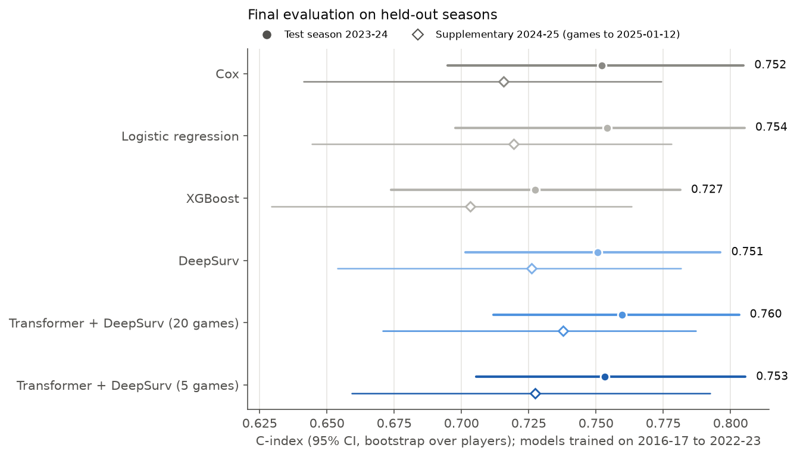
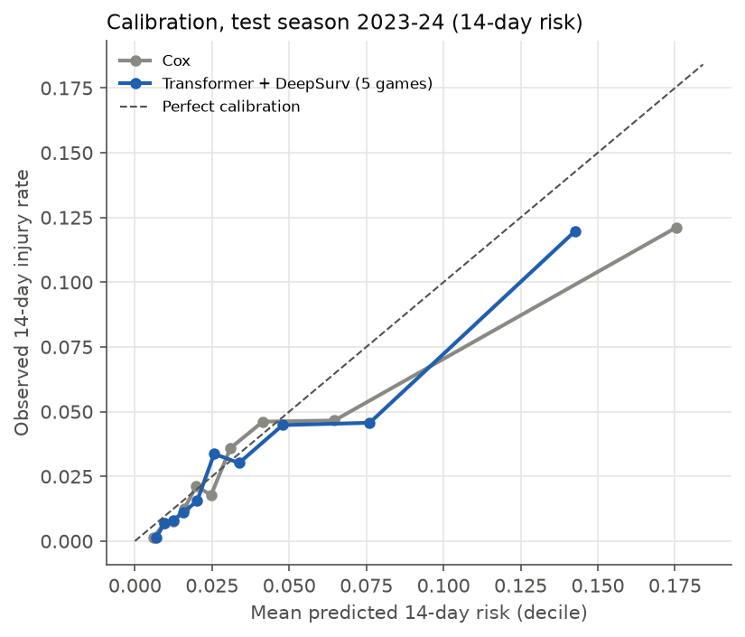
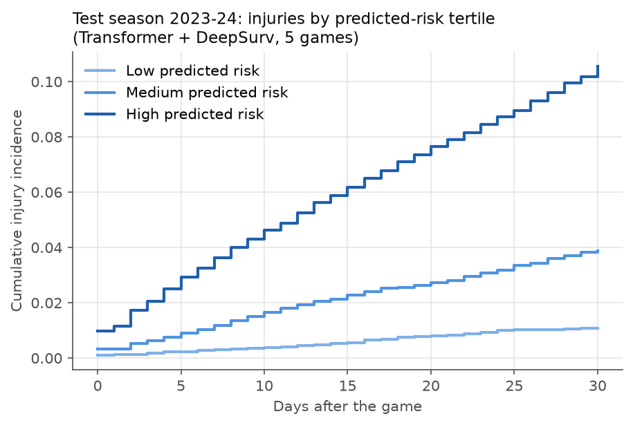

# Final evaluation on held-out seasons

All models were refit on 2016-17 to 2022-23 (training + validation seasons) with the settings fixed in Updates 2-3, then scored once. The primary comparison was fixed in Update 3, before the test season was used.

**Primary result (fixed in advance).** On the 2023-24 test season, Transformer + DeepSurv (5 games) reaches C-index 0.753 (0.705–0.805) vs. Cox 0.752 (0.695–0.805); difference +0.001, paired 95% CI -0.008 to +0.012 (1000 player resamples). The interval includes zero: the test season does not confirm a reliable advantage over Cox.

## Test season 2023-24

28,206 prediction points (player-games), 572 players, 1,159 with a target injury within the follow-up.

| model | c_index | c_95ci | c_minus_cox | paired_95ci | auc_14d | auc_95ci | brier_14d | mean_pred_14d | observed_14d |
|---|---|---|---|---|---|---|---|---|---|
| Cox | 0.752 | 0.695–0.805 | 0.000 |  | 0.765 | 0.710–0.812 | 0.030 | 0.040 | 0.032 |
| Logistic regression | 0.754 | 0.698–0.805 | 0.002 | -0.005 to +0.009 | 0.768 | 0.715–0.815 | 0.031 | 0.046 | 0.032 |
| XGBoost | 0.727 | 0.674–0.781 | -0.025 | -0.045 to -0.005 | 0.738 | 0.689–0.790 | 0.031 | 0.043 | 0.032 |
| DeepSurv | 0.751 | 0.702–0.796 | -0.002 | -0.015 to +0.014 | 0.763 | 0.715–0.812 | 0.030 | 0.038 | 0.032 |
| Transformer + DeepSurv (20 games) | 0.760 | 0.712–0.803 | 0.008 | -0.005 to +0.020 | 0.772 | 0.723–0.813 | 0.030 | 0.039 | 0.032 |
| Transformer + DeepSurv (5 games) | 0.753 | 0.705–0.805 | 0.001 | -0.008 to +0.012 | 0.765 | 0.717–0.817 | 0.030 | 0.039 | 0.032 |

## Supplementary 2024-25 (games to 2025-01-12)

12,335 prediction points (player-games), 519 players, 494 with a target injury within the follow-up.

| model | c_index | c_95ci | c_minus_cox | paired_95ci | auc_14d | auc_95ci | brier_14d | mean_pred_14d | observed_14d |
|---|---|---|---|---|---|---|---|---|---|
| Cox | 0.716 | 0.641–0.774 | 0.000 |  | 0.740 | 0.661–0.798 | 0.033 | 0.045 | 0.035 |
| Logistic regression | 0.719 | 0.644–0.778 | 0.004 | -0.003 to +0.011 | 0.742 | 0.662–0.802 | 0.033 | 0.047 | 0.035 |
| XGBoost | 0.703 | 0.629–0.763 | -0.013 | -0.046 to +0.026 | 0.723 | 0.643–0.778 | 0.033 | 0.042 | 0.035 |
| DeepSurv | 0.726 | 0.654–0.781 | 0.010 | -0.009 to +0.030 | 0.749 | 0.676–0.806 | 0.033 | 0.041 | 0.035 |
| Transformer + DeepSurv (20 games) | 0.738 | 0.671–0.787 | 0.022 | +0.009 to +0.039 | 0.757 | 0.687–0.809 | 0.033 | 0.042 | 0.035 |
| Transformer + DeepSurv (5 games) | 0.727 | 0.659–0.792 | 0.012 | -0.002 to +0.025 | 0.749 | 0.680–0.813 | 0.033 | 0.043 | 0.035 |

## Notes

- `c_minus_cox` and its paired 95% CI score both models on the same bootstrap resamples of players.
- Neural rows are 3-seed ensembles. `mean_pred_14d` vs `observed_14d` compares the average predicted 14-day risk with the observed rate (landmarks whose 14-day status is known).
- Gradient boosting implementation: XGBoost.
- The supplementary season ends at the end of the injury data (2025-01-12), so it covers the first half of 2024-25 only.

## Neural training (per seed)

| model | seed | epochs | inner_c |
|---|---|---|---|
| deepsurv | 0 | 12 | 0.720 |
| deepsurv | 1 | 12 | 0.702 |
| deepsurv | 2 | 9 | 0.782 |
| tf20 | 0 | 10 | 0.743 |
| tf20 | 1 | 6 | 0.699 |
| tf20 | 2 | 8 | 0.786 |
| tf5 | 0 | 7 | 0.726 |
| tf5 | 1 | 5 | 0.699 |
| tf5 | 2 | 8 | 0.782 |