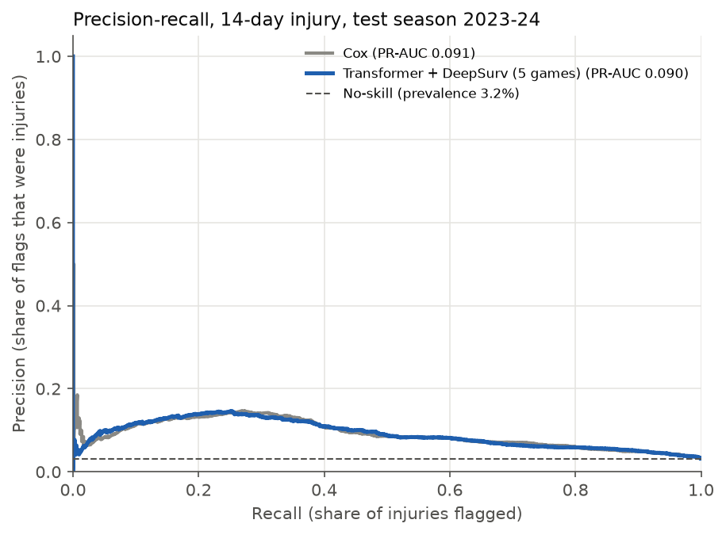

# Event-prediction metrics at 14 days

Computed from the locked final predictions (no refitting). Only player-games whose 14-day status is known are used. Precision, recall and F2 are reported when the model flags a fixed share of player-games (top 5%, 10%, 20% by predicted risk); no threshold was tuned. PR-AUC 95% CIs come from 200 bootstrap resamples of players. Compare PR-AUC with the prevalence, which is what a model with no skill would score.

## Test season 2023-24

22,544 player-games with known 14-day status, 715 injured within 14 days (prevalence 3.17%).

| model | pr_auc | pr_auc_ci | prevalence | precision_top5 | recall_top5 | f2_top5 | precision_top10 | recall_top10 | f2_top10 | precision_top20 | recall_top20 | f2_top20 |
|---|---|---|---|---|---|---|---|---|---|---|---|---|
| Cox | 0.091 | 0.062–0.130 | 0.032 | 0.133 | 0.210 | 0.188 | 0.121 | 0.382 | 0.267 | 0.084 | 0.529 | 0.256 |
| Logistic regression | 0.094 | 0.065–0.134 | 0.032 | 0.139 | 0.220 | 0.197 | 0.120 | 0.378 | 0.264 | 0.086 | 0.543 | 0.263 |
| XGBoost | 0.071 | 0.050–0.100 | 0.032 | 0.083 | 0.131 | 0.118 | 0.082 | 0.259 | 0.181 | 0.081 | 0.508 | 0.246 |
| DeepSurv | 0.097 | 0.060–0.144 | 0.032 | 0.129 | 0.203 | 0.182 | 0.108 | 0.340 | 0.238 | 0.082 | 0.519 | 0.252 |
| Transformer + DeepSurv (20 games) | 0.098 | 0.065–0.146 | 0.032 | 0.140 | 0.221 | 0.198 | 0.123 | 0.389 | 0.272 | 0.087 | 0.548 | 0.266 |
| Transformer + DeepSurv (5 games) | 0.090 | 0.062–0.128 | 0.032 | 0.143 | 0.225 | 0.202 | 0.120 | 0.378 | 0.264 | 0.083 | 0.522 | 0.253 |

## Supplementary 2024-25 (games to 2025-01-12)

8,881 player-games with known 14-day status, 311 injured within 14 days (prevalence 3.50%).

| model | pr_auc | pr_auc_ci | prevalence | precision_top5 | recall_top5 | f2_top5 | precision_top10 | recall_top10 | f2_top10 | precision_top20 | recall_top20 | f2_top20 |
|---|---|---|---|---|---|---|---|---|---|---|---|---|
| Cox | 0.108 | 0.063–0.165 | 0.035 | 0.153 | 0.219 | 0.201 | 0.116 | 0.331 | 0.242 | 0.084 | 0.479 | 0.247 |
| Logistic regression | 0.108 | 0.064–0.166 | 0.035 | 0.155 | 0.222 | 0.204 | 0.127 | 0.363 | 0.265 | 0.086 | 0.489 | 0.252 |
| XGBoost | 0.092 | 0.052–0.156 | 0.035 | 0.133 | 0.190 | 0.175 | 0.107 | 0.305 | 0.223 | 0.084 | 0.482 | 0.248 |
| DeepSurv | 0.088 | 0.055–0.140 | 0.035 | 0.133 | 0.190 | 0.175 | 0.117 | 0.334 | 0.244 | 0.093 | 0.531 | 0.273 |
| Transformer + DeepSurv (20 games) | 0.098 | 0.064–0.148 | 0.035 | 0.131 | 0.186 | 0.172 | 0.118 | 0.338 | 0.246 | 0.094 | 0.537 | 0.276 |
| Transformer + DeepSurv (5 games) | 0.104 | 0.064–0.164 | 0.035 | 0.158 | 0.225 | 0.207 | 0.115 | 0.328 | 0.239 | 0.095 | 0.540 | 0.278 |

