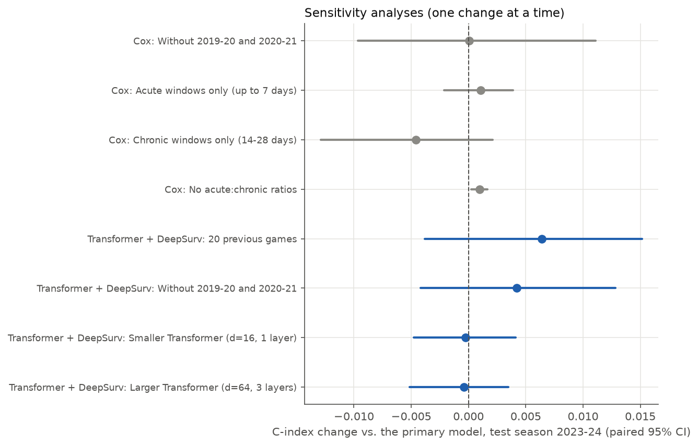

# Sensitivity analyses (test season 2023-24)

Each row changes one thing and is refit the same way as the final models; `delta` is the change in C-index against that model's primary version, with a paired 95% CI over 200 player resamples. These are descriptive: none of them was used to choose or change the final models.

| group | model | variant | c_index | delta | paired_95ci | auc_14d |
|---|---|---|---|---|---|---|
| Primary | Cox | Final model | 0.752 | 0.000 |  | 0.765 |
| Seasons | Cox | Without 2019-20 and 2020-21 | 0.752 | 0.000 | -0.010 to +0.011 | 0.763 |
| Workload definition | Cox | Acute windows only (up to 7 days) | 0.753 | 0.001 | -0.002 to +0.004 | 0.766 |
| Workload definition | Cox | Chronic windows only (14-28 days) | 0.748 | -0.005 | -0.013 to +0.002 | 0.758 |
| Workload definition | Cox | No acute:chronic ratios | 0.753 | 0.001 | +0.000 to +0.002 | 0.766 |
| Primary | Transformer + DeepSurv | Final model (5 games) | 0.753 | 0.000 |  | 0.765 |
| Sequence length | Transformer + DeepSurv | 20 previous games | 0.760 | 0.006 | -0.004 to +0.015 | 0.772 |
| Seasons | Transformer + DeepSurv | Without 2019-20 and 2020-21 | 0.758 | 0.004 | -0.004 to +0.013 | 0.767 |
| Architecture | Transformer + DeepSurv | Smaller Transformer (d=16, 1 layer) | 0.753 | -0.000 | -0.005 to +0.004 | 0.764 |
| Architecture | Transformer + DeepSurv | Larger Transformer (d=64, 3 layers) | 0.753 | -0.000 | -0.005 to +0.003 | 0.764 |

